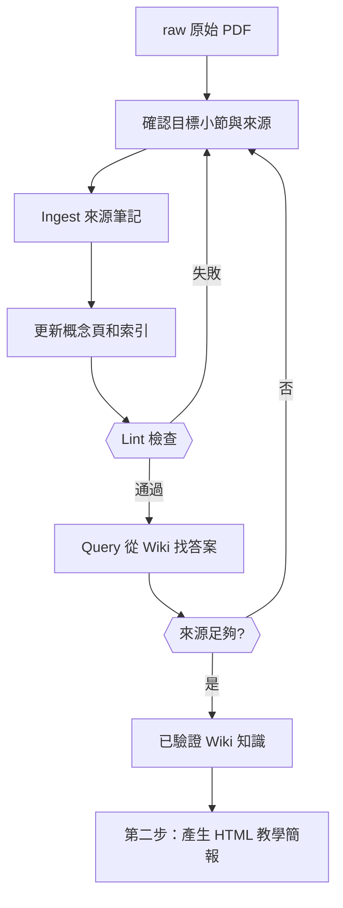

# Psychology LLM Wiki｜心理學入門知識庫

本專案參考 [Andrej Karpathy 的 LLM Wiki 構想](https://gist.github.com/karpathy/442a6bf555914893e9891c11519de94f)，將 **OpenStax《Psychology 2e》中的 7 個教材小節**轉成可追溯的繁體中文 Markdown Wiki。這是同一本開放教材的 7 個不同小節，**不是 7 篇獨立研究論文**。

> **目前進度：步驟一已完成。** 已建立 7/7 筆來源閱讀筆記、核心概念頁、索引、Ingest 日誌與本地檔案檢查紀錄；第二步的教學 HTML 簡報尚未製作。

## 為什麼選擇心理學？

目標讀者是沒有心理學背景的初學者。先從心理學科學研究、認知與記憶開始，再理解古典與操作制約、情緒理論及社會影響，讓讀者將心理學概念連接日常經驗。Wiki 與之後的 HTML 簡報都使用繁體中文，必要時保留英文專業術語。

## 7 筆原始資料

| ID | 教材小節 | 主要主題 | Wiki 整理 |
|---|---|---|---|
| S01 | §1.1 [What Is Psychology?](https://openstax.org/books/psychology-2e/pages/1-1-what-is-psychology) | 心理學是什麼 | [來源筆記](wiki/papers/source01.md) |
| S02 | §7.1 [What Is Cognition?](https://openstax.org/books/psychology-2e/pages/7-1-what-is-cognition) | 認知與概念 | [來源筆記](wiki/papers/source02.md) |
| S03 | §8.1 [How Memory Functions](https://openstax.org/books/psychology-2e/pages/8-1-how-memory-functions) | 記憶如何運作 | [來源筆記](wiki/papers/source03.md) |
| S04 | §6.2 [Classical Conditioning](https://openstax.org/books/psychology-2e/pages/6-2-classical-conditioning) | 古典制約 | [來源筆記](wiki/papers/source04.md) |
| S05 | §6.3 [Operant Conditioning](https://openstax.org/books/psychology-2e/pages/6-3-operant-conditioning) | 操作制約 | [來源筆記](wiki/papers/source05.md) |
| S06 | §10.4 [Emotion](https://openstax.org/books/psychology-2e/pages/10-4-emotion) | 情緒與情緒理論 | [來源筆記](wiki/papers/source06.md) |
| S07 | §12.4 [Conformity, Compliance, and Obedience](https://openstax.org/books/psychology-2e/pages/12-4-conformity-compliance-and-obedience) | 從眾、順從與服從 | [來源筆記](wiki/papers/source07.md) |

以上 7 份 PDF 都放在 `raw/`，由使用者提供的 OpenStax 全書 PDF 依小節所涉及的頁面拆分而成。由於有些段落與相鄰小節共用頁面，Ingest 以小節標題作為真正邊界；完整檔名、頁碼與連結見 [`raw/SOURCES.md`](raw/SOURCES.md)。

## 專案架構

```text
Psychology-LLM-Wiki/
├── AGENTS.md                # GPT 維護規則
├── README.md
├── raw/                     # 7 份 PDF 與 SOURCES.md（原始資料）
├── wiki/
│   ├── index.md             # 主題及頁面索引
│   ├── log.md               # Ingest / 檢查操作日誌
│   ├── papers/              # 7 個來源小節閱讀筆記
│   ├── concepts/            # 概念頁及來源對照
│   ├── entities/            # 研究者資訊
│   └── syntheses/           # 跨來源教學比較
├── reports/
│   ├── lint-step1.md        # 實際本地檢查
│   └── query-step1.md       # 實際檔案式 Query 測試
├── notes/                   # 第二步：簡報大綱與來源映射
├── slides_html/             # 第二步：HTML 簡報
└── assets/                  # 第二步：已授權媒體
```

## 先討論、後生成

建立前已先確認主題、初學者受眾、七個小節、Markdown 檔案結構、繁體中文、唯讀 `raw/`、來源追蹤與 Ingest / Query / Lint 流程。確認後再建立 [`AGENTS.md`](AGENTS.md)，最後將來源內容整理到 `wiki/`。規則規定不得把「只有檔案」冒充「已完成匯入」，也不得在資料不足時憑空補寫。

## Ingest → Query → Lint 工作流程



**這是規劃的回圈／圖設計，不代表實際已發生失敗返工。** 若 Lint 不通過，回到 Ingest 和概念整理；若 Query 缺少知識，回到來源補充。第二步完成後才加入 HTML 功能測試與回流紀錄。

## 步驟一：實際完成與檢查紀錄

- **7 個 Ingest 筆記：** [`wiki/papers/`](wiki/papers/) — 每篇包含來源、印刷頁碼、主要概念、限制與 Wiki 概念連結。
- **知識索引：** [`wiki/index.md`](wiki/index.md)。
- **Ingest 日誌：** [`wiki/log.md`](wiki/log.md)。
- **本地 Lint：** [`reports/lint-step1.md`](reports/lint-step1.md) — 檢查 PDF 可讀性、小節標題、來源引用和內部 Markdown 連結。
- **Query 路徑測試：** [`reports/query-step1.md`](reports/query-step1.md) — 檢查 5 個教學問題可以定位到已有 Wiki 概念與來源。

**檢查界線：** 這不是完整的語意事實查核、網路連結即時可用性或自動 Agent 系統。已產生繁體中文的來源性概念整理；若需更嚴格的逐段對照，可在第二步前追加審核。沒有捏造 FAIL → 重試的執行紀錄。

## 如何用 GPT 繼續下一步

1. 先讀 `AGENTS.md`、`raw/SOURCES.md` 與 `wiki/index.md`。
2. 從 Wiki 製作 `notes/slide_map.md`：每頁至少對應一個 Wiki 頁面和一個 `S01–S07` 原始來源。
3. 依 `notes/slide_map.md` 產生可以在瀏覽器切換頁面的 `slides_html/index.html`。
4. 檢查內容映射、投影片功能，並在 `reports/` 保存真實問題、修正與重測；最後才撰寫反思。

## 資料來源、公開與授權

- 原始出版單位：**OpenStax / Rice University**；教材：[*Psychology 2e*](https://openstax.org/details/books/psychology-2e)。
- 使用者提供的 PDF 版權頁標示 **©2026 Rice University，CC BY-NC-SA 4.0**（署名－非商業－相同方式分享）。本專案僅用於非商業教育用途；公開分享時保留作者／出版單位、教材連結與原始頁面上 **“Access for free at openstax.org”** 的來源標示。
- 以上 PDF 不是本專案自行撰寫；原書內的部分圖片另有個別標示，不應自行假定圖片全部都可自由商用。
- 本 Wiki 新增的整理內容如構成教材改作，公開分享時應遵守相同授權條款並清楚標示改作。


## 步驟二：教學型 HTML 簡報

已根據本專案 `wiki/papers/` 七篇來源筆記與 `wiki/concepts/` 建立 **13 頁心理學入門 HTML 簡報**。

- 開啟 [`slides_html/index.html`](slides_html/index.html) 可在瀏覽器直接瀏覽。
- 支援上一頁／下一頁、方向鍵、首頁／末頁、進度顯示及列印。
- 每頁均附上 Wiki 來源筆記與原始教材連結。
- 投影片與 Wiki 來源對照：[`reports/slide-source-map.md`](reports/slide-source-map.md)。
- 此階段為簡報產製；完整 Loop / Graph 反思將在作業後續步驟另行記錄。
